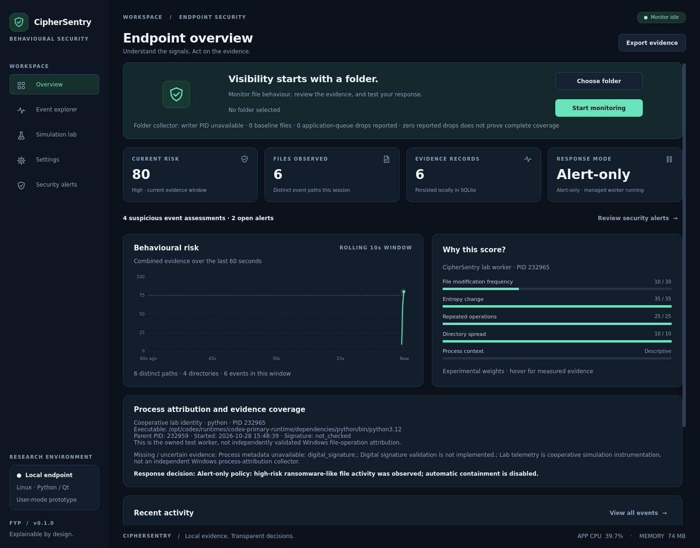

# CipherSentry

**An explainable behavioural ransomware-like activity research prototype for Windows endpoints.**

CipherSentry is a native Python + PySide6 desktop application. It combines real folder notifications, configurable behavioural rules, local evidence history, and harmless controlled experiments. The updated prototype preserves the existing application and defaults to **alert-only**: a high score does not itself authorize a process action.



## Run on Windows

Install **64-bit Python 3.12**, including the Python launcher, from [python.org](https://www.python.org/downloads/windows/). In Command Prompt, open this project folder and run:

```bat
setup_windows.bat
run_windows.bat
```

Equivalent commands are:

```powershell
py -3.12 -m venv .venv
.venv\Scripts\python.exe -m pip install -r requirements-dev.txt
.venv\Scripts\python.exe -m ciphersentry
```

The supported folder/lab workflow requires ordinary access to the selected files and the application's own child process, not administrator privileges. The initial installation downloads pinned dependencies; application evidence and communication stay local. No FastAPI server, browser frontend, cloud account, or API key is required.

The development host is Linux. Linux/offscreen Qt checks do not establish Windows correctness. Windows installation, notification behaviour, process control, and performance must still be checked on your Windows test machine. No packaged Windows `.exe` is included.

## Try the updated workflow

1. Open **Settings**. The response policy starts in **alert-only** mode. Earlier settings from the first prototype are also migrated to alert-only; automatic lab response requires a new explicit opt-in.
2. Open **Simulation lab** and run **Rapid modification burst**. It creates 60 disposable files in a new directory and changes them to deterministic high-entropy bytes. No encryption or malware is used. By default the workload continues even if its assessment reaches High risk.
3. Review **Overview**, **Event explorer**, and **Security alerts**. Inspect the measured indicators, missing evidence, and reason containment was or was not attempted. Acknowledging an alert records a review action; it does not mark a process safe or remove evidence.
4. Run **Ordinary bulk text edits** and **Run benign ZIP creation** as benign controls. The ZIP workload uses real standard-library archive compression, retains its dummy originals, and records newly created archives with unknown before-entropy. These simple controls do not replace testing representative archive tools, legitimate encryption, backup, and other high-I/O applications.
5. To demonstrate a real pause, explicitly enable simulation response in **Settings**, then run a fresh suspicious scenario. Only the verified lab child can be suspended. **Release worker** resumes it and bypasses automatic pause for the remainder of that run. **Stop experiment** stops only that child. Manual pause is also limited to the owned worker.
6. For actual folder observations, select a disposable document folder with **Choose folder → Start monitoring**, then edit a test file. Ordinary folder events remain **Unattributed** because this collector cannot identify the writer.
7. Export **JSON** for events, assessment explanations, response decisions, actions, and alerts, or **CSV** for event evidence. JSON is the input for offline ablation comparisons.

The dashboard's current score uses an expiring window. Old events leave that window, while historical assessments and alerts remain in SQLite. A Low result means limited evidence under the configured rules; it is not a safety guarantee.

## Five indicators and experimental settings

| Indicator | Current measurements | Default maximum points |
| --- | --- | ---: |
| File modification frequency | Modification observations/s and unique modified paths/s; repeated writes to one path are distinguished | 30 |
| Entropy change | Before/after byte-entropy samples; unavailable samples remain unknown | 35 |
| Repeated operations | Operation counts and adjacent transition types; no mandatory fixed sequence | 25 |
| Directory spread | Distinct immediate parent directories of modified files; nested parents each count once | 10 |
| Process context | Known lab PID, creation time, executable, parent, and available metadata | 0 |

These weights, the default **10-second** window, and thresholds **40 / 75** for Uncertain / High are configurable **development placeholders**, not approved or scientifically validated settings. Indicators can be disabled for comparison without rescaling other weights. Process context remains descriptive: it adds zero points even if a weight is configured, because no justified contextual risk rule is implemented. Digital signatures are marked `not_checked`; an unknown or familiar name is not used as a malware verdict. Rename suffixes are supporting operation information, not a separate fifth indicator.

## Attribution and response boundary

**Attribution** means identifying which process actually caused a file operation. **Context** means describing an already known process. `psutil` can collect context, but cannot turn a directory notification into reliable writer attribution.

The live folder watcher provides path-level observations with unknown PID. The lab has cooperative instrumentation and a directly launched child whose PID, creation time, and executable can be checked. Those lab events are explicitly labelled `cooperative_lab`; they do not demonstrate a general Windows attribution collector.

The risk engine produces an assessment. A separate response policy checks mode, evidence, source, stable identity, essential-process exclusions, active managed-worker state, and release state. OS control revalidates the registered child immediately before acting. Arbitrary applications are never automatically suspended or terminated by this prototype. See [Windows monitoring feasibility](docs/WINDOWS_MONITORING_FEASIBILITY.md) for the ETW investigation and decision gate.

## Architecture

```text
PySide6 dashboard + QSS
       │ direct Python interfaces / queued Qt signals
       ▼
Controller ───────── SQLite events, decisions, actions, alerts ── JSON / CSV
       │
       ├── Replaceable collector contract → FolderMonitor → sampled features
       ├── Owned lab QProcess ── local JSON-lines ───────────┐
       │                                                    ▼
       ├── Known-PID metadata                         RiskEngine / RiskConfig
       │                                                    │
       └── ManagedContainment ← separate response safety ←──┘
```

Folder observation and its initial baseline run outside the UI thread. The controller owns UI state and SQLite writes. The engine, metadata collector, response rules, and evidence store can be tested independently of Qt.

## Tests and feasibility tools

From the repository on Windows:

```powershell
.venv\Scripts\python.exe -m pytest -q
.venv\Scripts\python.exe -m scripts.attribution_probe --files 12 --output .ciphersentry\attribution-windows.json
.venv\Scripts\python.exe -m scripts.ablation evidence.json --output .ciphersentry\ablation.json
```

The attribution probe launches a harmless writer, records its real PID and creation time separately, and compares this ground truth with the independent folder collector. It reports observed/missing/duplicate fixture modifications, delivery delays, and attribution coverage. Unknown collector PIDs stay unknown.

The ablation tool replays the same exported observations with individual indicators removed. It reports score and threshold differences; it does not execute containment or establish detection accuracy. See [TESTING.md](docs/TESTING.md) for procedures and [VALIDATION.md](docs/VALIDATION.md) for recorded outcomes.

The updated local suite passed **86 tests on Linux**. A GitHub Actions matrix is included for Windows and Linux; adding that workflow is not evidence that the Windows job has passed.

Linux development:

```bash
python3 -m venv .venv
.venv/bin/python -m pip install -r requirements-dev.txt
QT_QPA_PLATFORM=offscreen .venv/bin/python -m pytest -q
QT_QPA_PLATFORM=offscreen .venv/bin/python -m ciphersentry \
  --data-dir .ciphersentry/headless --demo suspicious \
  --screenshot .ciphersentry/overview.png
```

Use the existing checkout for cloud tasks; each task already has an isolated environment. A separate Git worktree is unnecessary.

## Local files and research limits

Windows data defaults to `%LOCALAPPDATA%\CipherSentry`. Linux development uses `$XDG_DATA_HOME/CipherSentry` or `~/.local/share/CipherSentry`. Override this with `--data-dir PATH`.

- `evidence.sqlite3`: events, explanations, response decisions, actions, and alerts; the schema migrates additively and retains historical rows.
- `settings.json`: experimental configuration and response mode.
- `lab/`: independently created fixture directories, retained for review.
- `lab-results.jsonl`: completed or stopped lab-run records.

No sampled file contents or raw command-line values are stored in the evidence model. Exported paths and process metadata can still be sensitive. Close the application before archiving or removing its data directory. Automatic retention is future work. CPU/memory labels sample the dashboard process, not complete system overhead.

This project does not provide general antivirus coverage, ransomware family identification, file recovery/decryption, network-wide management, validated accuracy, or a zero-damage guarantee. High-entropy benign workloads and low-and-slow or partial changes remain important evaluation cases.

## Project documents

- [Feature status and gaps](docs/FEATURE_STATUS.md)
- [Development plan through INNOVATEX](docs/DEVELOPMENT_PLAN.md)
- [Research alignment](docs/RESEARCH_ALIGNMENT.md)
- [Windows monitoring feasibility](docs/WINDOWS_MONITORING_FEASIBILITY.md)
- [Testing instructions](docs/TESTING.md)
- [Evaluation methodology](docs/EVALUATION_PLAN.md)
- [Original proposal analysis](docs/PROPOSAL_ANALYSIS.md)

The provided proposal and updated instructions define requirements. The listed research papers are not available here as full texts and have not been treated as verified sources of methods or results.
