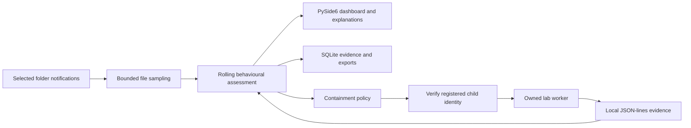

# CipherSentry: proposal analysis and prototype boundary

Source: the supplied **BICS 4321 FYP1 Project Proposal**, titled *CipherSentry: An Explainable Behavioural Ransomware Detection and Adaptive Containment System for Windows Endpoints*. The proposal is a requirements source; form instructions and readiness checklists in the PDF are not application requirements. The references supplied in the proposal have not been independently verified for this prototype.

## Updated project decisions

The later development instructions narrow the objective to early detection of file-encrypting ransomware-like behaviour and retain the native Windows desktop approach. The current policy defaults to alert-only; automatic lab suspension requires explicit simulation mode and a separate safety decision. The five indicators are modification frequency, entropy change, repeated operations, directory spread, and process context. Context is currently descriptive, while weights and thresholds remain configurable development placeholders. See [RESEARCH_ALIGNMENT.md](RESEARCH_ALIGNMENT.md) and [FEATURE_STATUS.md](FEATURE_STATUS.md) for the current implementation mapping.

## What the project is trying to demonstrate

The central problem is deciding **when accumulated behavioural evidence is strong enough to justify intervention**. Early intervention can reduce file impact, but ordinary compression, encryption, backup, build, and bulk editing workloads can resemble ransomware. Waiting for more evidence can reduce false alarms while allowing more changes to occur.

The prototype therefore needs a visible evidence-to-decision chain:

1. Collect file activity and available process information.
2. Measure several behaviours in a bounded time window.
3. Explain the contribution of each signal to an assessment.
4. Escalate from observation to review and, where the responsible process is reliably known and managed, temporary containment.
5. Preserve evidence so the decision and its practical effect can be evaluated.

The proposal's contribution is the combination and evaluation of these steps. A dashboard alone, an entropy threshold alone, or a malware signature lookup would not demonstrate that contribution.

## Why Option A fits

**Python with PySide6 is a practical choice for this FYP prototype.** Qt supplies a native desktop event loop, tables, dialogs, controls, and custom visualizations. Python can also implement feature extraction, deterministic scoring, SQLite persistence, and test tooling, keeping the initial architecture small enough to understand and evaluate.

Monitoring and worker I/O must not block Qt's main thread. File notifications arrive asynchronously; the application forwards their evidence to the UI through its controller. A separate lab process permits a real suspend/resume demonstration without suspending the dashboard itself. JSON lines carry only that worker's local progress and evidence. Other components use direct Python interfaces; no web server or cloud service is necessary.

The architecture supports Windows development, but Python and Qt do not themselves provide reliable system-wide file-operation attribution or tamper resistance. Those are separate engineering requirements.

## Mapping the proposal to the prototype

| Proposal requirement | Prototype implementation boundary | Work needed for the full research claim |
| --- | --- | --- |
| Real-time file monitoring | Watch a user-selected folder and record observable create, modify, move, and delete activity; sample file contents for entropy where accessible. | Measure notification loss, baseline races, file-lock behaviour, and sampling overhead on Windows. |
| Process-related evidence | The controlled lab worker has a known PID and lifecycle. Ordinary folder events have unknown process attribution. | Design and validate a Windows collector that correlates operations to process identity, including creation time and process trees. |
| Multiple behavioural signals | A bounded rolling window combines activity volume, entropy changes, spread, and operation patterns with explicit contributions. | Calibrate weights and thresholds against independent workloads; examine correlated evidence and evasion. |
| Explainability | Show the score, risk level, observed values, and reasons for each contributing signal. Persist the assessment with its event. | Evaluate whether explanations support accurate operator review; explain missing evidence as well as positive evidence. |
| Adaptive containment | Escalate using risk and evidence sufficiency; suspend, resume, or stop only the registered lab child. | Evaluate Windows process containment with reliable telemetry, policy exclusions, failure handling, and suitable privileges. |
| Experimental evaluation | Provide reproducible controlled scenarios, evidence export, and a separate evaluation protocol. | Run the controlled Windows experiments and legitimate application workloads; report measured results and uncertainty. |

Here, **adaptive** means that the response changes with accumulated evidence and policy. It does not mean an online-learning model or an experimentally optimized policy. Scores are illustrative heuristic scores, not probabilities that a process is ransomware.

## The important attribution boundary

Windows directory notifications, including those exposed through `watchdog`, generally identify a changed path and operation, not the PID that caused it. A process with a matching name or an open file is not enough to prove causation. Folder-level evidence can describe suspicious activity, but it must not be presented as a proven process accusation.

When simulation response is explicitly enabled, automatic action in this prototype is limited to the application's own registered child process, with identity checks before process control. This allows the detection-to-containment workflow to be demonstrated without assigning unrelated folder activity to arbitrary processes. The lab's telemetry is cooperative test instrumentation, not an adversary-resistant telemetry source.

A later Windows collector could investigate ETW file/process providers and correlation, or a filesystem minifilter for stronger operation-level control. Either path requires its own feasibility work, event-loss analysis, permissions design, and Windows testing. A minifilter additionally introduces driver development, signing, deployment, and kernel reliability requirements; it should not be implied by the present Python implementation.

## What the lab demonstrates

The lab creates disposable fixture files in its own fresh run directory. A suspicious scenario changes those generated files to high-entropy synthetic bytes and uses a visibly artificial extension. A benign scenario performs ordinary text changes at a comparable activity rate. Neither scenario is ransomware, and no decryption or recovery claim follows from these fixtures.

Running the suspicious scenario demonstrates evidence accumulation and an explainable threshold crossing. Alert-only mode leaves it running; explicit simulation response or a manual owned-worker pause can demonstrate the effect of suspension on further modifications. Running the benign scenario demonstrates one negative control. Passing these two scenarios is functional validation, not evidence of real-world ransomware detection accuracy. In particular, the benign text scenario does not represent the difficult legitimate encryption and compression cases highlighted by the proposal.

## Scope and limitations to retain in the dissertation

- **Scope:** local Windows endpoint behaviour, explainable assessment, containment decision review, and controlled experimental evaluation.
- **Excluded by the proposal:** decryption/file recovery, ransomware family identification, network ransomware detection, and Linux/macOS endpoint protection. Linux-based development checks do not establish Windows endpoint protection.
- **User-space limitations:** post-change notifications cannot guarantee prevention of the first modification, atomic containment, complete coverage, or protection against a privileged attacker.
- **Measurement limitations:** sampled entropy may miss partial or late-file changes; already-compressed files can have high entropy without being malicious; missing or unreadable samples are unknown evidence rather than low entropy.
- **Policy limitations:** fixed weights and thresholds require calibration. Multiple correlated signals do not automatically constitute independent evidence. Directory aggregation may combine activity from several legitimate processes.
- **Operational limitations:** suspending a real application can hold locks and interrupt legitimate work. Extending process control beyond the managed lab requires explicit policy and Windows validation.

## Suggested development sequence

1. Demonstrate the desktop workflow and deterministic engine tests with generated fixtures.
2. Validate installation, folder notifications, UI responsiveness, and child-process controls in an isolated Windows VM.
3. Integrate a Windows process-attribution collector behind the existing event interface.
4. Calibrate on development workloads, freeze the policy, and evaluate on separate workloads following [EVALUATION_PLAN.md](EVALUATION_PLAN.md).
5. Report detection, intervention, file impact, and overhead together, including failures and workloads the system cannot distinguish.
